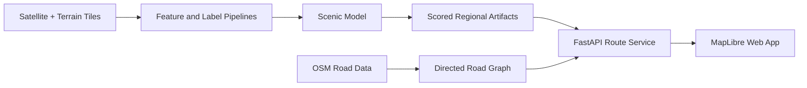

# Scenic Drive

Scenic Drive finds routes that trade a small amount of travel time for better scenery. It combines satellite imagery, terrain signals, learned scenic scores, and a directed road graph behind a FastAPI service and a lightweight MapLibre web app.

The canonical default product surface is the **New England North** web app. It compares the fastest route with a scenic alternative, renders regional scenic scores, and exposes the active model result. The API also has a route-capable **Northeast Expanded** region for cross-region coverage; Masswhites, Philadelphia, and Pittsfield remain validation-only.

## What is here

- **Route comparison** — fastest and scenic routes with distance, duration, and scenic-score deltas.
- **Learned scenic scoring** — satellite embeddings, terrain features, classifier signals, and mixed human/heuristic labels.
- **Regional web app** — a static MapLibre client with no frontend build step.
- **Reproducible operations** — locked Python dependencies, artifact manifests, container definitions, and focused CI checks.



## Quick start

### Requirements

- Python 3.11+
- [`uv`](https://docs.astral.sh/uv/)
- A Mapbox access token for map tiles and address search
- Node.js 20+ only for the viewer test

Install the locked development environment:

```bash
uv sync --frozen --extra dev
```

Start the API:

```bash
export MAPBOX_ACCESS_TOKEN=<your-token>
uv run uvicorn src.app_api.main:app --host 0.0.0.0 --port 8080 --reload
```

In another terminal, serve the static app:

```bash
cd apps/new_england_north
python3 -m http.server 3000
```

Open <http://localhost:3000>. Useful API endpoints:

- Health: <http://localhost:8080/v1/healthz>
- Interactive API reference: <http://localhost:8080/scalar>

A clean checkout can run the API and app shell. Heatmaps and route comparison require the ignored graph, report, registry, and model artifacts described in the [deployment guide](docs/setup/deployment.md).


## Repository layout

```text
apps/new_england_north/  Static MapLibre web app
src/app_api/             FastAPI application and contributor endpoints
src/route_planner/       Graph, cost, planning, cancellation, and service logic
src/classifier/          Landscape classifier training and inference
src/scenic_scorer/       Learned scenic regression
src/terrain/             Terrain-RGB feature extraction
src/heuristics/          Labeling and report generation
src/data_pipeline/       Tile and S3 data access
scripts/                 Grouped workflow CLIs
notebooks/               Interactive marimo workflows
config/                  Region and storage configuration
deploy/                  Versioned beta artifact manifests
docs/                    Architecture, setup, research, and roadmap
archive/                 Curated historical material
```

## Common workflows

| Goal | Entry point |
|---|---|
| Plan or execute source-versioned NAIP/3DEP tiles | `scripts/ingest/plan_active_learning_region.py` |
| Annotate scenic labels | `notebooks/annotate_scenic.mo.py` or `scripts/annotation/annotate_scenic_web.py` |
| Plan, score, select, and annotate an active-learning batch | `scripts/ingest/plan_active_learning_region.py`, `scripts/modeling/score_active_learning_pool.py`, and `scripts/annotation/select_active_learning.py` |
| Train and evaluate scoring | `notebooks/regression.mo.py` and `scripts/modeling/` |
| Generate regional reports | `scripts/reports/heuristic_report.py` |
| Build an OSM road graph | `scripts/routing/build_graph_from_osm.py` |
| Compare routes | `scripts/routing/route_compare_service.py` |
| Run remote training | `scripts/remote/` and the [Vast.ai runbook](docs/setup/vast-training.md) |

Run a marimo workflow with, for example:

```bash
uv run marimo edit notebooks/regression.mo.py
```

Stage-One active-learning runs are isolated under
`data/processed/active_learning/<run_name>/`. The active acquisition planner is
NAIP/3DEP-only and performs no network access by default:

```bash
uv run python scripts/ingest/plan_active_learning_region.py \
  --run-name <run_name> \
  --region-spec config/data_sources/regions_v1.json \
  --region-source config/app_regions.json \
  --imagery-source naip-visualization \
  --terrain-source usgs-3dep-13as \
  --source-contract config/data_sources/naip_3dep_v1.json \
  --image-root data/raw/sources/naip_3dep_v1/images \
  --output-root data/processed/active_learning \
  --budget 370000
```

When catalogs are absent, execute only the exact hash-bound `resume_command`
written to `<run_name>/discovery_authorization_request.json`, and only after
its positive discovery caps are explicitly authorized. Once discovery has
produced a pinned catalog and immutable plan, acquisition is separately
authorized:

```bash
uv run python scripts/ingest/plan_active_learning_region.py \
  --execute-plan data/processed/active_learning/<run_name>/execution_plan.json \
  --expected-plan-sha256 <execution_plan_sha256> \
  --allow-requester-pays \
  --max-source-requests <count> \
  --max-transfer-bytes <bytes> \
  --max-local-bytes <bytes> \
  --max-requester-pays-usd <usd> \
  --workers 8
uv run python scripts/modeling/score_active_learning_pool.py --manifest data/processed/active_learning/<run_name>/tile_manifest.csv --run-name <run_name>
uv run python scripts/annotation/select_active_learning.py --candidate-input data/processed/active_learning/<run_name>/candidate_pool.csv --prior-annotations data/raw/labels_human.csv --run-name <run_name>
uv run python scripts/annotation/annotate_scenic_web.py --batch-csv data/processed/active_learning/<run_name>/annotation_batch.csv --annotations-csv data/raw/labels_human.csv --raw-dir data/raw/sources/naip_3dep_v1
uv run python scripts/modeling/build_mixed_labels.py --heuristic-labels data/processed/active_learning/<run_name>/candidate_pool.csv --annotations-csv data/raw/labels_human.csv --geographic-splits-csv data/processed/active_learning/<run_name>/geographic_splits.csv --output data/processed/active_learning/<run_name>/mixed_labels.csv
uv run python scripts/annotation/build_human_benchmark.py --annotations-csv data/raw/labels_human.csv --geographic-splits-csv data/processed/active_learning/<run_name>/geographic_splits.csv --output-dir data/processed/active_learning --run-name <run_name>
uv run python scripts/annotation/finalize_stage1.py --run-root data/processed/active_learning/<run_name> --run-name <run_name>
```

`scripts/annotation/annotate_scenic_web.py` accepts repeatable
`--trusted-authority <host[:port]>` values in addition to its loopback default.
Public DNS names, wildcard binds, and reverse-proxy deployments must list every
served authority explicitly or the annotator rejects the request as
`untrusted_host`.

`scripts/annotation/build_source_shift_batch.py` accepts `--image-root <dir>`,
the directory both sources' satellite tiles live under. `image_path` is emitted
relative to it and the summary records it as `image_root`; point the annotator's
`raw_dir` at exactly that root so one annotator serves both sources. It defaults
to the deepest common directory of the sampled satellite tiles.

Train one bounded deterministic Stage-Two candidate from an admitted handoff:

```bash
uv run python scripts/modeling/train_active_scenic.py \
  --handoff data/processed/active_learning/<run_name>/stage1_handoff.json \
  --output-dir data/processed/active_learning/<run_name>/training \
  --epochs 20 --batch-size 64 --max-steps 200 --max-seconds 1800 --device auto
```

The Stage-Two autoresearch orchestrator validates the Stage-One handoff, the
control dataset, both human benchmarks, route QA, and the decision thresholds
before starting work. `--control-dataset` must be a control feature dataset NPZ
that is disjoint from the expanded prepared dataset, and `--thresholds-json` is
required for every non-dry execution:

```bash
uv run python scripts/modeling/run_active_scenic_autoresearch.py \
  --handoff data/processed/active_learning/<run_name>/stage1_handoff.json \
  --run-name <run_name> \
  --expanded-benchmark-csv data/processed/active_learning/<run_name>/expanded_human_benchmark.csv \
  --control-benchmark-csv data/processed/active_learning/<run_name>/control_benchmark.csv \
  --control-dataset <control_feature_dataset.npz> \
  --route-qa-json data/processed/active_learning/<run_name>/route_qa.json \
  --thresholds-json <decision_thresholds.json> \
  --max-experiments 3 --max-steps 200 --max-seconds 1800 --device auto
```

Use `--dry-run` to validate inputs and persist only the planned experiment
ladder.


The finalizer fails closed unless acquisition, scoring, human annotation,
fixed geographic splits, human benchmark, mixed labels, artifact hashes, and
the active baseline identity all validate.

After a bounded NAIP/3DEP pilot exists, freeze the matched source-pair batch
before annotation, then evaluate the unchanged model against the completed
human labels. Source identities must be explicit in both tile manifests:

```bash
uv run python scripts/annotation/build_source_shift_batch.py \
  --old-manifest <mapbox_tile_manifest.csv> \
  --new-manifest data/processed/active_learning/<run_name>/tile_manifest.csv \
  --old-source-identity <mapbox_source_contract_sha256> \
  --new-source-identity <naip_3dep_source_contract_sha256> \
  --image-root <shared_satellite_tile_root> \
  --output-batch-csv data/processed/active_learning/<run_name>/source_shift_batch.csv \
  --output-summary-json data/processed/active_learning/<run_name>/source_shift_batch.summary.json \
  --sample-size 200 --seed 42
uv run python scripts/modeling/evaluate_source_shift.py \
  --batch-summary-json data/processed/active_learning/<run_name>/source_shift_batch.summary.json \
  --annotations-csv data/raw/labels_human.csv \
  --old-predictions-csv <mapbox_predictions.csv> \
  --new-predictions-csv <naip_3dep_predictions.csv> \
  --output-report-json data/processed/active_learning/<run_name>/baseline_source_shift.json \
  --seed 42 --n-bootstrap 1000 --strict
```

Learned heatmap export requires a JSON identity manifest that hash-binds the
dataset, metadata, source, preprocessing, grid, classifier, regression,
calibration, score schema, and label schema. It never infers these identities:

```bash
uv run python scripts/modeling/export_prediction_heatmap.py \
  --dataset <feature_embeddings.npz> \
  --expected-dataset-sha256 <sha256> \
  --metadata-csv <candidate_pool.csv> \
  --expected-metadata-sha256 <sha256> \
  --checkpoint <checkpoint.pt> \
  --expected-checkpoint-sha256 <sha256> \
  --identity-manifest <prediction_identity.json> \
  --run-name <experimental_run_name>
```

## Additional CLI contracts

Several modeling, report, and remote-training commands gained required or
newly-documented inputs:

- `scripts/modeling/build_mixed_labels.py` and
  `scripts/modeling/run_regression_pipeline.py` require
  `--geographic-splits-csv <path>`, the run's fixed `image_path`/`split`
  assignments. Mixed labels are only ever built against that fixed snapshot, and
  the builder drops rows outside it.
- `scripts/modeling/train_regression_baseline.py` requires
  `--benchmark-split-csv <path>`, the fixed benchmark split whose validation and
  test identities are excluded from training before the internal split. The
  trainer receives its validation membership explicitly and persists it as a
  split artifact (`--split-artifact`, default `<output stem>.split.json`).
- `scripts/modeling/evaluate_regression_baseline.py` requires
  `--split-artifact <path>`, the split artifact written during training. It
  reproduces exactly the trained model's validation membership through the
  shared derivation in `scripts/modeling/regression_split.py` and fails on any
  drift; it never derives a validation split from the dataset alone.
- `scripts/modeling/run_regression_pipeline.py` requires
  `--baseline-checkpoint <path>` in addition to `--benchmark-split-csv`, so the
  candidate is compared against an explicit baseline rather than an inferred one.
- `scripts/reports/heuristic_report.py` accepts `--learned-run-json <path>`,
  attested learned run metadata that supplies missing checkpoint identities.
  Declared identities must match the loaded artifacts; the report never infers
  them.
- `scripts/remote/vast_train.py run` requires `--benchmark-split-key <s3-key>`,
  the exact S3 object key of the benchmark split CSV whose validation and test
  identities are excluded from training. See the
  [Vast.ai runbook](docs/setup/vast-training.md).
- `notebooks/learned_scoring.mo.py` requires the per-run
  `cfg.benchmark_split_csv` configuration value (no default): set it to the run's
  benchmark split CSV, which the notebook passes on as `--benchmark-split-csv`.
  It passes `cfg.split_artifact` to both training and evaluation, and evaluation
  fails when the artifact is absent.

## Documentation

- [Architecture](docs/architecture/infrastructure.md) — current offline and online system boundaries
- [Data layout](data/README.md) — canonical local and S3 artifact paths
- [Deployment](docs/setup/deployment.md) — required beta artifacts, bootstrap, validation, and startup
- [AWS/S3 setup](docs/setup/aws-s3.md) — credentials, bucket layout, sync, and lifecycle policy
- [Remote training](docs/setup/vast-training.md) — container and Vast.ai lifecycle
- [Roadmap](docs/roadmap.md) — current product, model, data, and routing priorities
- [ML research log](docs/research/ml-research-log.md) — learned-score model history and promotion evidence
- [Nationwide streaming score-map proposal](docs/research/nationwide-streaming-score-map.md) — proposed score-only CONUS architecture, cost hypothesis, and required gates
- [Routing performance research](docs/research/routing-performance-autoresearch.md) — current conclusions, benchmark evidence, rejected experiments, and reproducible figures
- [Archive manifest](archive/archive.md) — historical, non-primary material
- [Changelog](CHANGELOG.md) — user-visible contract changes

## Tests

```bash
uv run pytest -q
node --test tests/test_new_england_north_viewer.mjs
```

These are the same two gates run by GitHub Actions.

## Project boundaries

- Model weights, datasets, generated reports, road graphs, caches, and credentials stay outside Git.
- The responsive web app is canonical; the archived native app is not active.
- Remote training is operator-run, not a hosted training service.
- The repository is a private source preview, not a self-contained data or model release.

## License

Private repository — not for distribution. All rights reserved; see [LICENSE](LICENSE).
